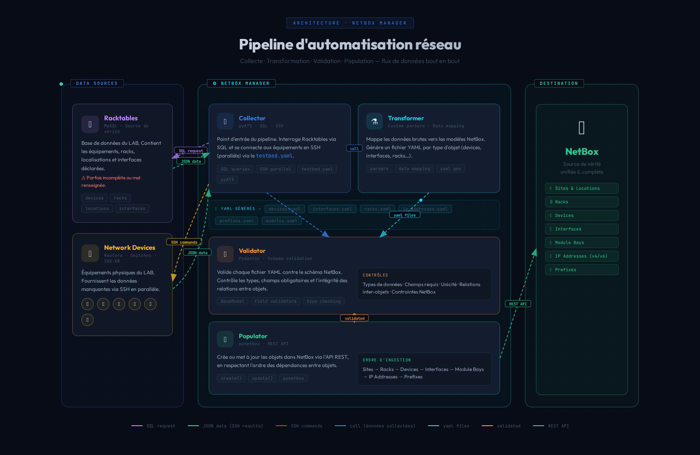

# NetBox Manager - Comprehensive Documentation

## Table of Contents

1. [Overview](#overview)
2. [Architecture](#architecture)
3. [Project Structure](#project-structure)
4. [Core Components](#core-components)
5. [Installation & Setup](#installation--setup)
6. [Configuration](#configuration)
7. [Usage Guide](#usage-guide)
8. [Data Transformers](#data-transformers)
9. [Schema Validation](#schema-validation)
10. [Network Integration](#network-integration)
---

## Overview

**NetBox Manager** is a professional Python automation tool designed to populate and manage NetBox infrastructure data from multiple external sources. It bridges the gap between legacy systems (like RackTables) and modern NetBox IPAM/DCIM, providing a robust data transformation pipeline with enterprise-grade features.

### Key Features

- **Multi-Source Data Ingestion**: Import from RackTables database, network devices (via pyATS), and custom sources
- **Intelligent Data Transformation**: Converts heterogeneous data formats into NetBox-compatible structures
- **Schema Validation**: Pydantic-based validation ensures data integrity before NetBox operations
- **Smart Create/Update Logic**: Automatically detects existing objects and performs differential updates
- **Network Device Integration**: Directly query network devices for OS version, module types, and configurations
- **Auto-Dependency Resolution**: Automatically creates missing manufacturers, platforms, and related objects
- **Cable Auto-Creation**: Generates cable connections from interface custom fields

### Supported NetBox Objects

- Regions and Site Groups
- Tenants
- Sites and Racks
- Device Roles and Device Types
- Devices and Modules
- Interfaces (physical and virtual)
- Console Ports
- IP Addresses (IPv4/IPv6)
- Cables
- Custom Fields

---

## Architecture

### High-Level Architecture



### Data Flow Pipeline

1. **Raw Data Extraction**: Gather data from external sources (RackTables MySQL, network devices via pyATS)
2. **Transformation**: Convert raw data to NetBox-compatible format using specialized transformers
3. **Validation**: Validate transformed data against Pydantic schemas
4. **NetBox Operations**: Create or update NetBox objects via API
5. **Verification**: Optional network device validation and report generation

### Architecture Layers

| Layer | Components | Responsibility |
|-------|-----------|----------------|
| **Data Sources** | RackTables DB, pyATS, YAML | External data providers |
| **Transformer Layer** | BaseTransformer, RackTablesTransformer, NetworkTransformer | Data normalization and conversion |
| **Validation Layer** | Pydantic Schemas | Data structure and type validation |
| **Business Logic** | NetboxManager, Utility Functions | NetBox operations and orchestration |
| **Integration Layer** | pynetbox, pyATS | External API clients |
| **Presentation** | CLI, Jenkins | User interfaces |

---

## Project Structure

```
netbox-manager/
├── main.py                      # Primary entry point (pyATS job)
├── Readme.md                    # Quick start guide
├── check_parser.py              # Parser validation utility
│
├── common/                      # Configuration and data files
│   ├── config/
│   │   ├── config.yaml          # NetBox connection settings
│   │   ├── mapping_data.yaml    # Data transformation mappings
│   │   └── objects.yaml         # NetBox object definitions
│   ├── data/
│   │   ├── raw/                 # Raw data from sources (RackTables)
│   │   ├── netbox/              # Transformed NetBox-ready data
│   │   └── network/             # Network device data
│   └── parsers/                 # TextFSM/Genie parsers (18 parsers)
│
├── controller/                  # Command execution and reporting
│   ├── commands.py              # Network command execution
│   ├── parser.py                # Output parsing logic
│   └── report.py                # Report generation
│
├── models/                      # Device and module type definitions
│   ├── device-types/            # NetBox device type YAML files
│   ├── module-types/            # Module type definitions
│   └── platforms/               # Platform definitions
│
├── schemas/                     # Pydantic validation schemas
│   ├── __init__.py
│   ├── site.py                  # Site schema
│   ├── rack.py                  # Rack schema
│   ├── device_role.py           # Device role schema
│   ├── device_type.py           # Device type schema
│   ├── device.py                # Device schema
│   ├── module.py                # Module schema
│   ├── interface.py             # Interface schema
│   ├── ip_address.py            # IP address schema
│   ├── console_ports.py         # Console port schema
│   ├── region.py                # Region schema
│   ├── site_group.py            # Site group schema
│   └── tenant.py                # Tenant schema
│
├── transformers/                # Data transformation pipeline
│   ├── __init__.py
│   ├── basetransformer.py       # Abstract base transformer
│   ├── racktables.py            # RackTables-to-NetBox transformer
│   └── network.py               # Network device data transformer
│
├── utils/                       # Core utilities
│   ├── __init__.py
│   ├── classes.py               # NetboxManager, GetLogger, Transformer
│   └── functions.py             # Helper functions (1200+ lines)
│
├── racktables/                  # RackTables integration
│   └── racktables_db_extract.py # MySQL database extraction
│
├── testbeds/                    # pyATS testbed configurations
│   └── testbed.yaml             # Device connection info
│
├── triggers/                    # pyATS trigger logic
│   └── trigger.py               # Custom trigger implementations
│
├── datafiles/                   # pyATS datafiles for testing
│
├── sdk/                         # Custom SDK extensions
│
└── requirements/
    └── requirements.txt         # Python dependencies
```

---

## Core Components

### 1. NetboxManager Class (`utils/classes.py`)

The central orchestration class for all NetBox operations.

**Key Methods:**

```python
class NetboxManager:
    def __init__(self, url: str, token: str)

    # Object Management
    def create_or_update_site(self, data: dict)
    def create_or_update_device(self, data: dict)
    def create_or_update_interface(self, data: dict)
    def create_or_update_ip_address(self, data: dict)
    def create_or_update_cable(self, data: dict)
    def create_or_update_rack(self, data: dict, site: str)
    def create_or_update_device_role(self, data: dict)
    def create_or_update_device_type(self, data: dict)
    def create_or_update_module(self, data: dict)
    def create_or_update_console_port(self, data: dict)
    def create_or_update_region(self, data: dict)
    def create_or_update_tenant(self, data: dict)
    def create_or_update_site_group(self, data: dict)

    # Helper Methods
    def _compare_and_update(self, existing_obj, new_data, excluded_keys)
    def _apply_update(self, obj, diff, description)
    def _prepare_device_data(self, data, validate_required)
    def get_device(self, name: str)
    def get_rack(self, name: str, site: str)
    def close_netbox_session(self)
```

**Features:**
- Automatic create/update detection with differential comparison
- Nested object resolution (sites, device types, roles)
- Custom field support
- Error handling with detailed logging
- Session management

### 2. Transformer Base Class (`transformers/basetransformer.py`)

Abstract base for all data transformers with pipeline pattern.

```python
class BaseTransformer:
    def __init__(self, mapping, testbed, site):
        self.mapping = mapping
        self.testbed = testbed
        self.site = site
        self.result = {}

    def pipeline(self) -> List[Callable]:
        """Override to define transformation pipeline"""
        raise NotImplementedError

    def transform(self, raw_data: List[Dict]):
        """Execute transformation pipeline"""
        for row in raw_data:
            for transform_func in self.pipeline():
                transform_func(row)
        return self.result
```

### 3. RackTables Transformer (`transformers/racktables.py`)

Converts RackTables database exports to NetBox format.

**Pipeline:**
1. `transform_devices` - Create device objects from RackTables objects
2. `transform_interfaces` - Extract physical and virtual interfaces
3. `transform_ip_addresses` - Convert IP allocations
4. `transform_console_ports` - Extract console connections

**Key Features:**
- OS detection from device naming conventions
- Interface normalization (vendor abbreviations → NetBox types)
- Cable label extraction
- Rack position mapping

### 4. Network Transformer (`transformers/network.py`)

Enriches NetBox data with live network device information via pyATS.

**Capabilities:**
- Module type and OS version extraction
- Device height (U) calculation
- Serial number collection
- Hardware inventory

### 5. Pydantic Schemas (`schemas/*.py`)

Strict validation models for all NetBox objects.

**Example: Device Schema**
```python
class DeviceCreate(BaseModel):
    name: Annotated[str, StringConstraints(min_length=2)]
    site: str
    role: str
    device_type: str
    status: str = Field("active", pattern="^(active|offline|planned|staged|failed|decommissioning)$")

    model_config = ConfigDict(extra='allow')
```

**Validation Benefits:**
- Type safety
- Required field enforcement
- Enum validation for status fields
- Early error detection before API calls

### 6. Utility Functions (`utils/functions.py`)

Over 40+ helper functions for common operations:

**Key Functions:**
- `parse_args()` - CLI argument parsing
- `load_data_from_file()` - YAML/JSON file loading
- `populate_netbox()` - Main orchestration function
- `validate_devices()` - Testbed device validation
- `generate_datafiles()` - pyATS datafile generation
- `execute_tasks()` - Parallel network task execution
- `deep_merge()` - Recursive dictionary merging
- `normalize_dashes()` - String normalization
- `load_testbed_directory()` - Multi-file testbed loading

### 7. Controller Components

**Commands (`controller/commands.py`):**
- Network command execution framework
- Support for show commands with pyATS parsers

**Parser (`controller/parser.py`):**
- TextFSM and Genie parser integration
- Custom parser selection logic
- 18 specialized parsers for Cisco devices

**Report (`controller/report.py`):**
- Automated documentation generation
- Device facts and inventory reports

---

## Installation & Setup

### Prerequisites

- **Python**: 3.8 or higher
- **NetBox**: 3.x or later
- **Database Access**: MySQL client for RackTables (optional)
- **Network Access**: SSH access to network devices (for pyATS features)

### Installation Steps

```bash
# 1. Clone the repository
git clone <repository-url>
cd netbox-manager

# 2. Create virtual environment
python3 -m venv venv
source venv/bin/activate  # On Linux/Mac
# venv\Scripts\activate   # On Windows

# 3. Install dependencies
pip install --upgrade pip
pip install -r requirements/requirements.txt
```

### Dependencies

Key packages (from `requirements/requirements.txt`):

```
pynetbox==7.5.0          # NetBox Python API client
pyats[full]==25.11       # Network automation framework
pydantic==2.12.3         # Data validation
PyYAML==6.0.3            # YAML parsing
pandas==2.3.3            # Data manipulation
netaddr==1.3.0           # IP address handling
netutils==1.15.1         # Network utility functions
mysqlclient==2.2.7       # RackTables database access
```

### Environment Setup

**For Production Use:**
```bash
# Set up virtual environment in standard location
sudo mkdir -p /opt/venv
sudo python3 -m venv /opt/venv/netbox-manager
sudo chown -R $USER:$USER /opt/venv/netbox-manager
source /opt/venv/netbox-manager/bin/activate
pip install -r requirements/requirements.txt
```

---

## Configuration

### 1. NetBox Connection (`common/config/config.yaml`)

```yaml
netbox:
  url: "https://netbox.example.com"
  token: "your-netbox-api-token-here"
  inventory_file: "common/config/netbox-data.yaml"
```

**How to get NetBox API token:**
1. Log into NetBox web interface
2. Navigate to user profile → API Tokens
3. Create new token with appropriate permissions
4. Copy token to configuration file

### 2. Object Definitions (`common/config/objects.yaml`)

Defines paths for each NetBox object type:

```yaml
netbox_objects:
  - tenants
  - regions
  - sites
  - racks
  - custom_fields
  - device_roles
  - devices
  - modules
  - bundles
  - interfaces
  - ip_addresses
  - console_ports
  - cables

tenants:
  path: "common/data/netbox/tenants.yaml"

devices:
  path: "common/data/netbox/devices.yaml"

interfaces:
  path: "common/data/netbox/interfaces.yaml"

# ... (additional object definitions)
```

### 3. Mapping Configuration (`common/config/mapping_data.yaml`)

Defines data transformation rules:

```yaml
# OS detection patterns
devices_os_supported_roles:
  iosxr: ["rr", "rrvpn", "co"]
  iosxe: ["ipsec", "pe-nim"]
  nxos: ["pesms", "7750"]

# Device role mappings
expected_netbox_roles:
  - router
  - switch
  - firewall
  - server

# Interface type mappings
interfaces_types:
  Gi: "1000base-t"
  Te: "10gbase-x-sfpp"
  Fo: "100gbase-x-qsfpp28"
  Et: "1000base-t"
  Po: "lag"
  Lo: "virtual"

# Interface abbreviation expansions
interface_abbreviation_mapping_table:
  ios:
    Gi: "GigabitEthernet"
    Te: "TenGigabitEthernet"
    Fa: "FastEthernet"
  nxos:
    Eth: "Ethernet"
  linux:
    eth: "eth"
```

### 4. Testbed Configuration (`testbeds/testbed.yaml`)

PyATS testbed for network device access:

```yaml
testbed:
  name: lab-testbed

devices:
  router-01:
    alias: router-01
    type: router
    os: iosxe
    platform: asr1000
    credentials:
      default:
        username: admin
        password: !vault |
          $ANSIBLE_VAULT;1.1;...
    connections:
      cli:
        protocol: ssh
        ip: 10.1.1.1
        port: 22

  switch-01:
    alias: switch-01
    type: switch
    os: nxos
    platform: n9k
    credentials:
      default:
        username: admin
        password: cisco123
    connections:
      cli:
        protocol: ssh
        ip: 10.1.1.2
```

---

## Usage Guide

### Basic Usage

#### 1. Populate Sites and Devices

```bash
python main.py \
  --raws-data racktables \
  --objects sites devices
```

#### 2. Full Infrastructure Deployment

```bash
python main.py \
  --raws-data racktables \
  --network-actions module_type_os_version \
  --objects tenants regions sites racks custom_fields device_roles devices modules bundles interfaces ip_addresses console_ports cables
```

### Command-Line Arguments

| Argument | Type | Description | Example |
|----------|------|-------------|---------|
| `--raws-data` | Required | Data source type | `racktables`, `gobgp` |
| `--objects` | Required | NetBox objects to process | `sites devices interfaces` |
| `--network-actions` | Optional | Network device actions | `module_type_os_version` |
| `--testbed` | Optional | pyATS testbed file | `testbeds/testbed.yaml` |
| `--continue-on-error` | Optional | Don't stop on errors | `--continue-on-error` |

### Object Processing Order

⚠️ **Important**: Process objects in dependency order to avoid errors:

```
1. tenants          # Must exist before sites
2. regions          # Geographic hierarchy
3. site_groups      # Site organization
4. sites            # Requires regions/tenants
5. racks            # Requires sites
6. custom_fields    # Before devices
7. device_roles     # Before devices
8. device_types     # Manufacturers auto-created
9. devices          # Requires site, role, type
10. modules         # Requires devices
11. bundles         # Interface groups
12. interfaces      # Requires devices
13. ip_addresses    # Requires interfaces
14. console_ports   # Requires devices
15. cables          # Requires interfaces/ports
```

### Advanced Workflows

#### Workflow 1: RackTables Migration

```bash
# Step 1: Extract RackTables data (done via racktables module)
# Data saved to common/data/raw/racktable-*.json

# Step 2: Transform and validate
python main.py \
  --raws-data racktables \
  --objects sites racks device_roles devices interfaces cables

# Step 3: Verify in NetBox UI
# Browse to NetBox and confirm objects created
```

#### Workflow 2: Network Device Enrichment

```bash
# Collect live data from network devices
python main.py \
  --raws-data racktables \
  --network-actions module_type_os_version \
  --objects devices modules

# This connects to devices via SSH and enriches:
# - OS versions
# - Module types
# - Serial numbers
# - Hardware inventory
```

#### Workflow 3: Incremental Updates

```bash
# Update only changed devices
python main.py \
  --raws-data racktables \
  --objects devices \

# The tool automatically detects existing objects
# and only updates changed fields
```

---

## Data Transformers

### Transformer Architecture

All transformers inherit from `BaseTransformer` and implement a pipeline pattern:

```python
class BaseTransformer:
    def pipeline(self) -> List[Callable]:
        """Define transformation steps"""
        raise NotImplementedError

    def transform(self, raw_data: List[Dict]):
        """Execute pipeline on each data row"""
        for row in raw_data:
            for transform_func in self.pipeline():
                transform_func(row)
        return self.result
```

### RackTables Transformer

**Source**: `transformers/racktables.py`

Converts RackTables MySQL database exports to NetBox-compatible YAML.

#### Pipeline Steps

1. **`transform_devices`**
   - Maps RackTables objects to NetBox devices
   - Resolves device roles from naming patterns
   - Extracts rack positions
   - Sets tenant from zone tags

   **Input:**
   ```json
   {
     "name": "router01-lab",
     "HW_type": "Cisco ASR-1001-X",
     "role_pattern": "router",
     "rackspace": {"rack_name": "R01", "unit": 10, "atom": "front"},
     "explicit_tags": ["lab-zone-1"]
   }
   ```

   **Output:**
   ```yaml
   devices:
     router01-lab:
       name: router01-lab
       status: active
       site: demo-lab
       role: router-lab
       device_type: ASR-1001-X
       rack: R01
       position: 10
       face: front
       tenant: zone-1
   ```

2. **`transform_interfaces`**
   - Normalizes interface names (vendor abbreviations)
   - Extracts cable labels
   - Maps interface types
   - Collects custom field data for auto-cabling

   **Processing:**
   - Physical ports: From RackTables interface table
   - Virtual interfaces: Extracted from IP address data
   - Console ports: Filtered separately

3. **`transform_ip_addresses`**
   - Converts IPv4/IPv6 addresses
   - Associates addresses with interfaces
   - Sets address roles (loopback, etc.)

4. **`transform_console_ports`**
   - Extracts console connections
   - Preserves cable labels
   - Links to remote devices

#### Interface Normalization

The transformer handles vendor-specific abbreviations:

```python
# IOS
"Gi0/0/0" → "GigabitEthernet0/0/0"
"Te1/1/1" → "TenGigabitEthernet1/1/1"

# NX-OS
"Eth1/1" → "Ethernet1/1"

# Linux
"eth0" → "eth0" (unchanged)
```

### Network Transformer

**Source**: `transformers/network.py`

Enriches NetBox data with live information from network devices.

**Key Functions:**

```python
class Network:
    def __init__(self, netbox_data, load_data, netbox_obj_definition, mapping):
        # Connect to devices and gather data
        self.gather_network_data()

    def gather_module_types(self, device):
        """Extract installed modules"""

    def gather_os_version(self, device):
        """Get OS version string"""
```

**Collected Data:**
- Module types and part numbers
- OS versions
- Chassis serial numbers
- Device heights (U calculation)

### Custom Transformer Development

To create a new transformer:

```python
from transformers.basetransformer import BaseTransformer

class CustomTransformer(BaseTransformer):
    def pipeline(self):
        return [
            self.transform_step1,
            self.transform_step2,
        ]

    def transform_step1(self, row: Dict):
        # Process row and update self.result
        devices = self.result.setdefault("devices", {})
        devices[row['name']] = {
            "name": row['name'],
            "site": self.site,
            # ... additional fields
        }
```

---

## Schema Validation

### Pydantic Schema System

Each NetBox object type has a corresponding Pydantic model that enforces:
- Required fields
- Data types
- Value constraints
- Enum validations

### Available Schemas

| Schema | File | Key Fields |
|--------|------|------------|
| Site | `schemas/site.py` | name, slug, status |
| Device | `schemas/device.py` | name, site, role, device_type, status |
| DeviceRole | `schemas/device_role.py` | name, slug, color |
| DeviceType | `schemas/device_type.py` | manufacturer, model, slug |
| Interface | `schemas/interface.py` | name, device, type, enabled |
| IPAddress | `schemas/ip_address.py` | address, device, interface, status |
| ConsolePorts | `schemas/console_ports.py` | name, device, type |
| Rack | `schemas/rack.py` | name, site, u_height |
| Module | `schemas/module.py` | device, module_type |
| Region | `schemas/region.py` | name, slug, parent |
| Tenant | `schemas/tenant.py` | name, slug, group |
| SiteGroup | `schemas/site_group.py` | name, slug, parent |

### Example: IP Address Schema

```python
from pydantic import BaseModel, Field
from typing import Optional

class IPAddressCreate(BaseModel):
    address: str  # CIDR notation (e.g., "10.1.1.1/24")
    device: str
    interface: str
    status: str = Field("active", pattern="^(active|reserved|deprecated|dhcp|slaac)$")
    vrf: Optional[str] = None
    tenant: Optional[str] = None
    role: Optional[str] = None
    description: Optional[str] = None

    model_config = ConfigDict(extra='allow')
```

### Validation Error Handling

```python
from schemas.device import DeviceCreate
from pydantic import ValidationError

try:
    device = DeviceCreate(**data)
except ValidationError as e:
    LOGGER.error(f"Validation failed: {e}")
    # Logs detailed field errors:
    # - Missing required fields
    # - Type mismatches
    # - Pattern violations
```

### Custom Validation

You can extend schemas with custom validators:

```python
from pydantic import field_validator

class DeviceCreate(BaseModel):
    name: str

    @field_validator('name')
    def name_must_be_lowercase(cls, v):
        if not v.islower():
            raise ValueError('Device name must be lowercase')
        return v
```

---

## Network Integration

### PyATS Integration

NetBox Manager uses Cisco pyATS for network device interaction.

#### Testbed Structure

```yaml
testbed:
  name: production
  tacacs:
    username: netadmin
  passwords:
    tacacs: env(TACACS_PASSWORD)

devices:
  core-router-01:
    alias: core-router-01
    type: router
    os: iosxe
    platform: asr1000
    connections:
      cli:
        protocol: ssh
        ip: 10.0.0.1
```

#### Network Actions

**Module Type & OS Version Collection:**

```bash
python main.py \
  --raws-data racktables \
  --network-actions module_type_os_version \
  --objects devices modules
```

**What happens:**
1. Load testbed configuration
2. Validate devices exist in both NetBox data and testbed
3. Connect to each device via SSH
4. Execute show commands
5. Parse output with Genie/TextFSM
6. Save structured data to YAML
7. Update NetBox with collected information

#### Supported Commands

The `controller/commands.py` module supports:

```python
COMMAND_MAP = {
    "show_version": "show version",
    "show_inventory": "show inventory",
    "show_module": "show module",
    "show_interfaces": "show interfaces",
    # ... additional commands
}
```

#### Custom Parsers

18 custom parsers in `common/parsers/`:

- `show_version.py` - OS version extraction
- `show_inventory.py` - Hardware inventory
- `show_module.py` - Module information
- `show_interfaces_*.py` - Interface details (per OS)
- ... and more

#### Parallel Execution

Network tasks execute in parallel for performance:

```python
from concurrent.futures import ThreadPoolExecutor

def execute_tasks(kwargs, devices, action_list, lock):
    with ThreadPoolExecutor(max_workers=10) as executor:
        futures = {
            executor.submit(run_task, device, actions): device
            for device in devices
        }
```

### Network Data Flow

```
Testbed YAML → Device Connection → Command Execution → Parser →
Structured Data → NetBox Transformer → NetBox API Update
```

---


## API Reference

### NetboxManager Public API

#### Initialize

```python
from utils.classes import NetboxManager

nb = NetboxManager(
    url="https://netbox.example.com",
    token="your-api-token"
)
```

#### Site Operations

```python
# Create or update a site
site_data = {
    "name": "Paris Datacenter",
    "slug": "paris-dc",
    "status": "active",
    "region": "EMEA"  # Optional
}
site = nb.create_or_update_site(site_data)
```

#### Device Operations

```python
# Create or update a device
device_data = {
    "name": "router-01",
    "site": "Paris Datacenter",
    "role": "router",
    "device_type": "ASR1001-X",
    "status": "active",
    "rack": "R01",  # Optional
    "position": 10,  # Optional
    "tenant": "Customer A"  # Optional
}
device = nb.create_or_update_device(device_data)

# Get existing device
device = nb.get_device("router-01")
```

#### Interface Operations

```python
# Create or update interface
interface_data = {
    "name": "GigabitEthernet0/0/0",
    "device": "router-01",
    "type": "1000base-t",
    "enabled": True,
    "mark_connected": False,
    "custom_fields": {
        "remote_device": "switch-01",
        "remote_port_name": "GigabitEthernet1/0/1"
    }
}
interface = nb.create_or_update_interface(interface_data)
```

#### IP Address Operations

```python
# Create or update IP address
ip_data = {
    "address": "10.1.1.1/24",
    "device": "router-01",
    "interface": "GigabitEthernet0/0/0",
    "status": "active",
    "role": "loopback"  # Optional
}
ip_address = nb.create_or_update_ip_address(ip_data)
```

#### Cable Operations

```python
# Auto-create cable from interface custom fields
nb.get_create_cable_from_interface_data(interface_data)

# Or manually create cable
cable_data = {
    "a_termination_type": "dcim.interface",
    "a_termination_device": "router-01",
    "a_termination_name": "GigabitEthernet0/0/0",
    "b_termination_type": "dcim.interface",
    "b_termination_device": "switch-01",
    "b_termination_name": "GigabitEthernet1/0/1",
    "label": "CABLE-001"
}
cable = nb.create_or_update_cable(cable_data)
```

#### Rack Operations

```python
rack_data = {
    "name": "R01",
    "site": "Paris Datacenter",
    "u_height": 42,
    "status": "active"
}
rack = nb.create_or_update_rack(rack_data, site="Paris Datacenter")
```

#### Device Type Operations

```python
device_type_data = {
    "manufacturer": "Cisco",
    "model": "ASR1001-X",
    "slug": "asr1001-x",
    "u_height": 2
}
device_type = nb.create_or_update_device_type(device_type_data)
# Note: Manufacturer auto-created if missing
```

#### Cleanup

```python
# Close NetBox session properly
nb.close_netbox_session()
```
